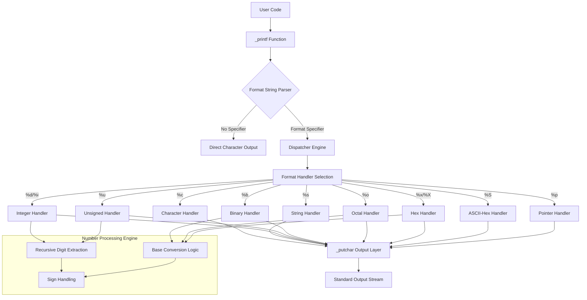
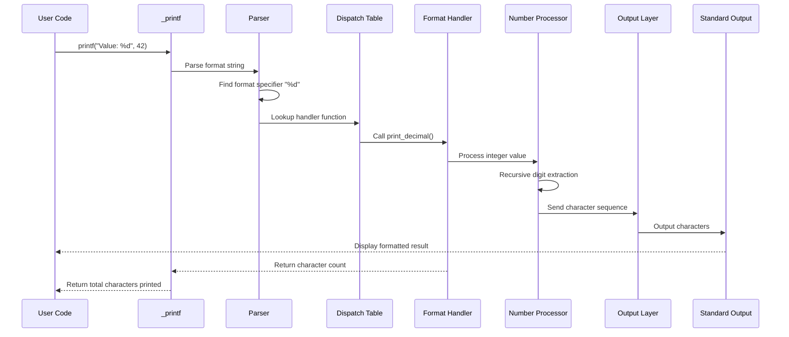
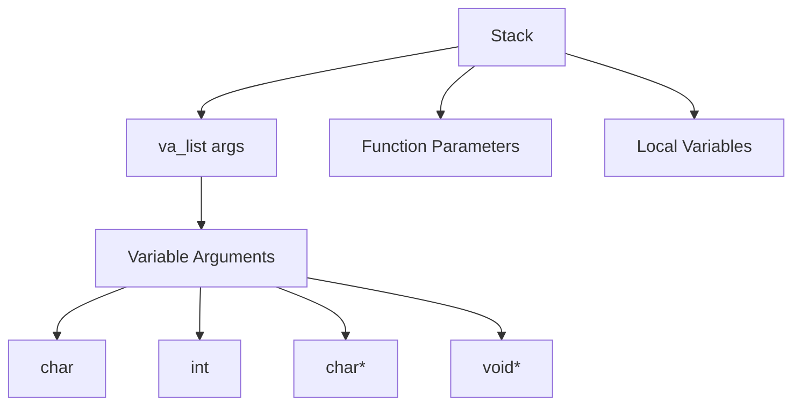
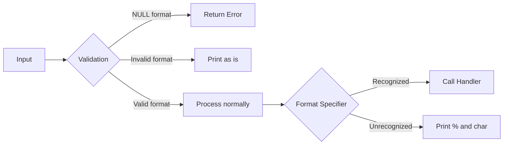
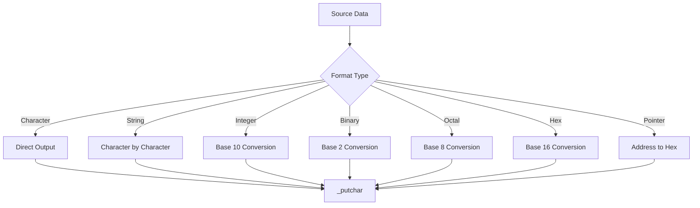

# 🏗️ System Architecture

## 📖 Overview
The custom printf implementation follows a modular, function pointer-based architecture designed for extensibility, maintainability, and performance. The system employs a dispatch table pattern for format specifier handling, recursive algorithms for number processing, and a layered approach separating format parsing from output generation.

---

## 🏛️ High-Level Architecture



The architecture emphasizes separation of concerns with distinct layers for parsing, dispatching, processing, and output generation.

---

## 🧩 Core Components

### Format String Parser & Dispatcher
- **Purpose**: Parses format strings and routes specifiers to appropriate handlers
- **Technology**: C with function pointer arrays and variadic macros
- **Location**: `_printf.c`
- **Responsibilities**:
  - Character-by-character format string analysis
  - Format specifier identification and validation
  - Variadic argument list management
  - Function dispatch table lookup and execution
  - Return value calculation and aggregation

### Character & String Processing Layer
- **Purpose**: Handles character and string format specifiers with safety validation
- **Technology**: C with pointer arithmetic and string manipulation
- **Location**: `print_char.c`
- **Responsibilities**:
  - Single character output formatting (%c)
  - String output with null pointer safety (%s)
  - String length calculation and validation
  - Character encoding and special character handling

### Numeric Processing Engine
- **Purpose**: Converts and formats numeric values across multiple data types
- **Technology**: C with recursive algorithms and mathematical operations
- **Location**: `print_dec.c`
- **Responsibilities**:
  - Signed integer processing (%d, %i)
  - Unsigned integer processing (%u)
  - Recursive digit extraction algorithms
  - Sign detection and negative number handling
  - Zero and edge case management

### Base Conversion System
- **Purpose**: Implements number base conversion algorithms for multiple representations
- **Technology**: C with mathematical algorithms and character mapping
- **Location**: `print_base.c`
- **Responsibilities**:
  - Binary conversion algorithms (%b)
  - Octal number conversion (%o)
  - Hexadecimal conversion (lowercase %x, uppercase %X)
  - Base arithmetic and modular operations
  - Character mapping for non-decimal representations

### Advanced Format Handler
- **Purpose**: Manages complex format specifiers requiring special processing
- **Technology**: C with ASCII manipulation and pointer arithmetic
- **Location**: `print_printf.c`
- **Responsibilities**:
  - Non-printable ASCII character handling (%S)
  - Memory address formatting (%p)
  - Special character escaping and hex conversion
  - Pointer validation and address representation

### Output Abstraction Layer
- **Purpose**: Provides low-level character output abstraction
- **Technology**: C with system call interface
- **Location**: `_putchar.c`
- **Responsibilities**:
  - Single character output to standard output
  - System call interface abstraction
  - Cross-platform output compatibility
  - Character count tracking for return values

---

## 📊 Data Flow Architecture



### Processing Pipeline Stages

1. **Input Validation**: Format string and argument validation
2. **Token Parsing**: Character-by-character format string analysis
3. **Specifier Recognition**: Format specifier identification and classification
4. **Handler Dispatch**: Function pointer lookup and execution
5. **Data Processing**: Type-specific value conversion and formatting
6. **Output Generation**: Character-level output through abstraction layer
7. **Result Aggregation**: Character count tracking and return value calculation

---

## 🔧 Technical Implementation Details

### Function Pointer Dispatch System
```c
typedef struct printf_struct
{
    char *c;                    // Format specifier string
    int (*f)(va_list args);     // Handler function pointer
} arr_printf;

arr_printf funcs[] = {
    {"c", print_char}, {"s", print_string},
    {"d", print_decimal}, {"i", print_int},
    {"b", print_binary}, {"u", print_unsigned},
    {"o", print_octal}, {"x", print_hex_lower},
    {"X", print_hex_upper}, {"S", print_ascii_hex},
    {"p", print_pointer}
};
```

### Variadic Argument Processing
- **va_list Initialization**: `va_start(args, format)` establishes argument list
- **Type-Safe Extraction**: Handlers use `va_arg(args, type)` for safe access
- **Memory Management**: `va_end(args)` ensures proper cleanup
- **Error Prevention**: Format validation prevents argument type mismatches

### Recursive Number Processing Algorithm
```c
int print_number(int num)
{
    int count = 0;
    
    if (num < 0)
    {
        _putchar('-');
        count++;
        num = -num;
    }
    
    if (num / 10)
        count += print_number(num / 10);
    
    _putchar(num % 10 + '0');
    return (count + 1);
}
```

---

## 🚀 Performance Characteristics

### Time Complexity Analysis
| Operation | Complexity | Description |
|-----------|------------|-------------|
| Format Parsing | O(n) | Linear scan of format string |
| Function Dispatch | O(1) | Direct table lookup |
| Integer Conversion | O(log n) | Recursive digit processing |
| String Output | O(n) | Character-by-character output |
| Base Conversion | O(log_b n) | Base-specific processing |

### Space Complexity
- **Stack Usage**: O(log n) for recursive number processing
- **Heap Allocation**: O(1) - no dynamic memory allocation
- **Function Dispatch**: O(1) constant space for function pointer table
- **Buffer Management**: O(1) direct output without intermediate buffering

### Optimization Strategies
- **Direct Output**: No intermediate string building or buffering
- **Function Pointer Caching**: Dispatch table eliminates repeated string comparisons
- **Recursive Tail Optimization**: Number processing uses stack-efficient recursion
- **Minimal Memory Allocation**: Stack-based processing prevents memory fragmentation

---

## 🛡️ Security & Safety Considerations

### Memory Safety
- **Buffer Overflow Prevention**: No fixed-size buffers used for processing
- **Null Pointer Validation**: All string inputs checked for null pointers
- **Stack Overflow Protection**: Recursive depth limited by number size
- **Type Safety**: Format specifiers validated against argument types

### Input Validation
- **Format String Validation**: Malformed format strings handled gracefully
- **Argument Count Verification**: Mismatch detection between specifiers and arguments
- **Range Checking**: Numeric values validated for representation limits
- **Character Encoding Safety**: Non-printable characters properly escaped

### Error Handling Strategy
- **Graceful Degradation**: Invalid inputs produce safe default outputs
- **Return Value Semantics**: Consistent character count reporting
- **Resource Cleanup**: Proper variadic argument list management
- **Cross-Platform Compatibility**: Portable across Unix-like systems

---

## 📈 Scalability & Extensibility

### Adding New Format Specifiers
1. **Handler Implementation**: Create new handler function following signature pattern
2. **Dispatch Registration**: Add entry to function pointer array
3. **Testing Integration**: Add comprehensive test cases for new specifier
4. **Documentation Update**: Update format specifier documentation

### Performance Scaling
- **Linear Scaling**: Performance scales linearly with format string length
- **Constant Handler Overhead**: Each format specifier has O(1) dispatch cost
- **Memory Efficiency**: No memory usage growth with input size
- **Compilation Optimization**: Compatible with aggressive compiler optimizations

### Maintenance Considerations
- **Modular Design**: Each component can be modified independently
- **Clear Interfaces**: Well-defined function signatures and return patterns
- **Comprehensive Testing**: Test suite validates all components and edge cases
- **Documentation Standards**: Consistent documentation across all modules

---

*This architecture emphasizes performance, safety, and maintainability while providing a comprehensive foundation for understanding printf implementation internals.*
        +print_octal()
        +print_hex_lower()
        +print_hex_upper()
        +print_ascii_hex()
        +print_pointer()
    }
    
    class UtilityFunctions {
        +_putchar()
        +print_number()
        +print_number_base()
        +print_number_base_upper()
    }
    
    _printf --> FormatHandlers : calls
    FormatHandlers --> UtilityFunctions : uses
```

## Memory Model



## Error Handling



## Data Transformation


